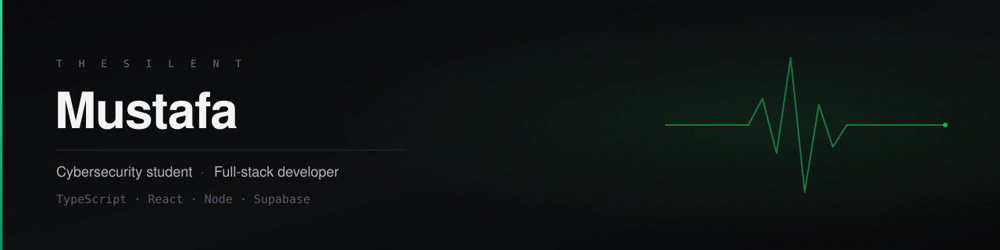

  

### Full-stack developer — TypeScript · React · Node · Supabase

I build web products end to end. Most of my work is private; what ships, ships quiet.

 

**Now**

- Building private products on `TypeScript` + `Supabase`
- Open to freelance work

**Selected work**

| Project | What it does |
| :-- | :-- |
| **VLESS Bridge** | Self-hosted Node.js traffic manager — per-subscriber TCP ports, live throughput metering, device and duration limits, automatic cut-off |
| **Pixel Vault** | Storefront with a points wallet, admin approval flow and WhatsApp top-ups &nbsp;·&nbsp; [live](https://pixel-vault-connect.lovable.app) |
| **Emerald Journeys** | Student access platform — name-based sessions, PIN admin, encrypted settings, dark mode |

All three are private repositories. Code walkthrough on request.

**Stack**

  
  
  
  
  

 

**Contact** &nbsp;·&nbsp; [@ee.zvz](https://instagram.com/ee.zvz)
